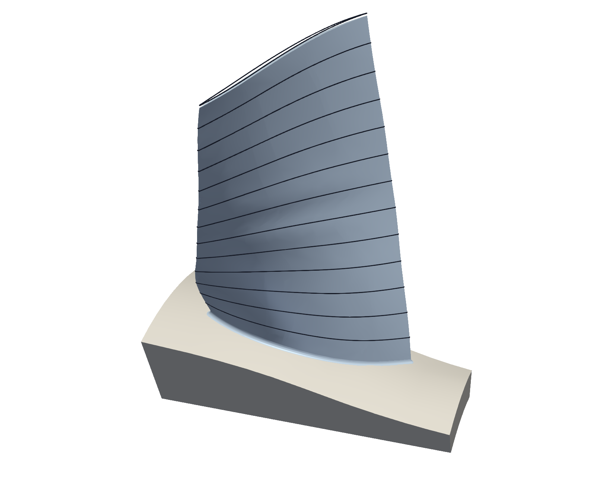
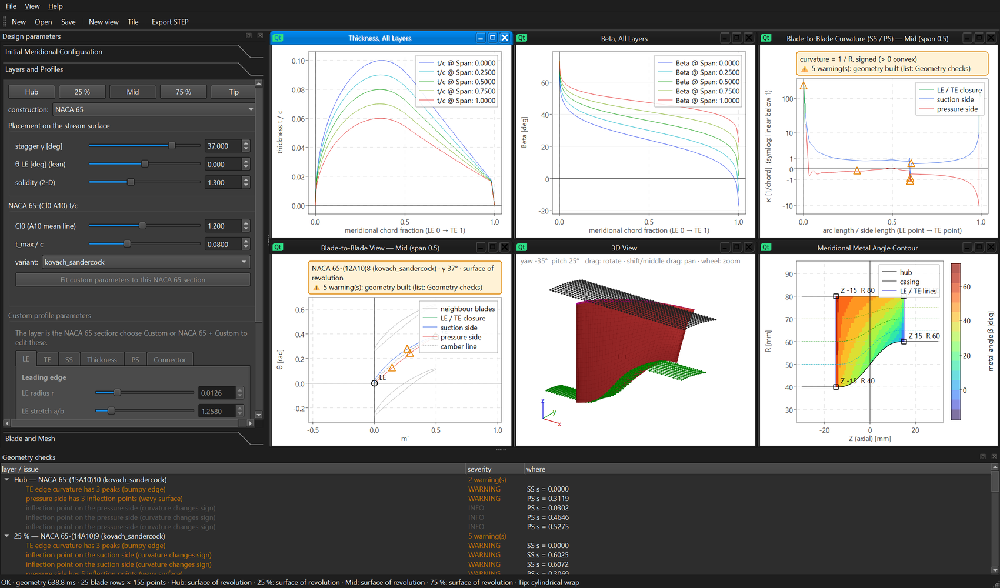

# BladeGen

**Parametric C2 turbomachinery blade generator in C++23 on OpenCASCADE** — the C++ successor of the
`blade2d` Python engine, with curvature-quality checks, inverse design from published coordinates, C2
NURBS blades, a rolling-ball hub fillet, Python bindings and interactive notebooks. It generates the
**parametric NACA 65 series** (the geometry of the TURBOlenza solver, since v1.0.1), and since v1.0.2 it has
**BladeGen Designer**, a native C++ / Qt multi-window program: the meridional channel from eight cylindrical
coordinates (Bell & Mehta or linear walls), five design layers, the metal-angle contour in the meridional
plane, and the meshed 3-D blade wrapped conformally onto its stream surfaces.

[](https://github.com/yilmaziz/BladeGen/actions/workflows/ci.yml)
 

[](LICENSE)

<p align="center">
  
  <br/><em>NASA Rotor 67 rebuilt by BladeGen from its 14 published sections (NASA TP-2879): the C2 NURBS blade
  solid on its hub sector with the 1.78 mm rolling-ball hub fillet; black lines are the 14 fitted stations
  (the top one is the casing contour, the tip sits 1.016 mm below it). The 3-D model of notebook
  <code>04_rotor67</code>, rendered by <code>tools/render_rotor67.py</code>.</em>
</p>

## Quick start

You need [Miniconda / Miniforge](https://conda-forge.org/download/) (any platform) and a C++ compiler:
Visual Studio 2022+ with the *Desktop development with C++* workload on Windows, GCC 13+ on Linux, Xcode
command-line tools on macOS.

```bash
git clone https://github.com/yilmaziz/BladeGen.git
cd BladeGen
conda env create -f environment.yml        # OCCT 7.9, Eigen, Catch2, pybind11, Ninja, JupyterLab, ...
```

**Open BladeGen Designer** (v1.0.2, C++ / Qt). One command builds it the first time (a few minutes), then
opens it; an environment created before v1.0.2 needs Qt once: `conda env update -f environment.yml`.

```bat
:: Windows (cmd or PowerShell, from the repository folder)
tools\designer.cmd                 :: optional: a design .json (also v1.0.1 designs); --rebuild after changing C++ code
```

```bash
# Linux / macOS (needs a desktop session)
conda activate bladegen
bash tools/designer.sh             # or: build/linux-release/bin/bladegen_designer [design.json]
```

<p align="center">
  
  <br/><em>BladeGen Designer: the parameter panel (meridional configuration, layers Hub / 25 % / Mid / 75 % / Tip,
  construction method and knobs, blade and mesh), six views (thickness and metal angle of all layers, SS / PS
  curvature with the issue markers, the blade-to-blade view in (m′, θ) with the neighbouring blades, the meshed
  3-D blade on hub and casing, the metal-angle contour in the meridional plane) and the geometry checks.</em>
</p>

How it works:

1. **Initial Meridional Configuration**: the hub and casing points at the LE and TE as Z (axial) and R, in mm;
   for each wall *Bell & Mehta* (fifth-order contour, zero slope and curvature at the LE and TE, cylinders
   upstream / downstream) or *Linear* (the straight line through the two points); inlet / outlet extensions.
2. **Layers and Profiles**: Hub, 25 %, Mid, 75 %, Tip, each with its own construction method (**NACA 65**,
   **Custom**, **NACA 65 + Custom** with the *Fit* button; DCA and C4 planned), its knobs by family and its
   placement (stagger γ from the m′ axis, θ of the LE for lean, 2-D solidity).
3. **Views** are MDI sub-windows. **Right-click a view** to choose its content (3D View, Blade-to-Blade View,
   Profile Section, Meridional Contour, Meridional Metal Angle / Thickness Contour, Meridional and
   Blade-to-Blade Curvature, LE/TE Theta / Beta / Parameters, Airfoil Area, Blade Information Table,
   Blade Angles, Beta / Theta / Beta vs. Theta / Thickness of all layers), its layer, the horizontal axis
   of the angle / thickness plots (meridional chord fraction, m′, m, x/c), the blade-to-blade coordinates
   ((m′, θ) or (m, rθ)), legend, points, status strip, swap / proportional / flipped axes, *Number of Points*,
   *Save Graph Data*, *Copy View Image*, *Zoom Fit*. *View → New view* opens more; *Tile* arranges them.
4. Every change is computed in C++ on a worker thread (the five layers in parallel, unchanged layers from a
   cache) and every view redraws: tens of milliseconds for a Custom or placement change, about 0.2 s more for
   a changed NACA 65 section. Lines are thin: **suction side blue, pressure side red, LE / TE closures green**.
5. Errors (S-shaped or looping LE / TE, self-intersection) and warnings appear in the views' status strips
   and in the *Geometry checks* dock (click an entry to select its layer).
6. *File → Save / Open* (`bladegen-design-2` JSON; v1.0.1 `bladegen-design-1` files open with the 25 % and
   75 % layers blended); *File → Export*: the blade solid as **STEP / IGES / BREP / STL** (OpenCASCADE C2 skin,
   trimmed by hub and casing), the blade / hub / casing mesh as OBJ, the layer coordinates as CSV.

Mouse: wheel zooms, drag pans, double-click fits; in the 3-D view drag rotates, Shift/middle-drag pans.

The v1.0.1 section window (Tk + matplotlib, hub / mid / tip 2-D sections, TURBOlenza CascadeSpec export)
is still there: `tools\gui.cmd` / `bash tools/gui.sh`.

**Open the notebooks.** The launcher builds the Python module the first time (a few minutes), then starts
JupyterLab in `python/notebooks`:

```bat
:: Windows (cmd or PowerShell, from the repository folder)
tools\jupyter.cmd                  :: later runs start at once; --rebuild after changing C++ code
```

```bash
# Linux / macOS
conda activate bladegen
bash tools/jupyter.sh               # --rebuild after changing C++ code, --port N for another port
```

Then open, in order: `01_profile_designer` (knobs by family, live curvature and error badge),
`02_blade_3d` (3-D blade, **Add hub fillet** button, STEP export), `03_inverse_fit` (NACA 65 from published
coordinates), `04_rotor67` (the rotor above). Stop the server with Ctrl+C in the terminal (closing the browser
tab leaves it running).

**Build and test the C++ library and the CLI:**

```bat
tools\win_dev.cmd windows-msvc-release        :: Windows: configure, build, run all tests
```

```bash
bash tools/linux_dev.sh linux-release         # Linux (or: macos-release on macOS)
./build/linux-release/bin/bladegen demo out/  # demo rotor -> out/demo_rotor.json, STEP files
```

## Platforms

| platform | compiler | OpenCASCADE | tested in CI | Python + notebooks | BladeGen Designer (Qt 6) |
|---|---|---|---|---|---|
| Windows 10 / 11 x64 | MSVC 19.4x (VS 2022), 19.5x (VS 2026) | 7.9 (conda-forge) | ✓ `windows-2022` | ✓ | ✓ Qt 6.10 (conda-forge) |
| Linux x86-64 (Ubuntu 24.04) | GCC 13 (apt), GCC 16 (conda) | 7.6 (apt), 7.9 (conda) | ✓ `ubuntu-24.04`, also ASan + UBSan | ✓ | ✓ Qt 6.4 (apt) / conda-forge |
| macOS arm64 (Apple Silicon) | AppleClang | 7.9 (conda-forge) | ✓ `macos-latest` | ✓ | ✓ Qt (conda-forge) |

The designer needs Qt 6 Widgets (in `environment.yml`; apt `qt6-base-dev`); without Qt the rest builds and the
designer is skipped (`-DBLADEGEN_BUILD_DESIGNER=AUTO|ON|OFF`). CI renders every view content of every layer
offscreen (`bladegen_designer --self-test`). The v1.0.1 section window is Tkinter + matplotlib.

All builds use `-Wall -Wextra -Wpedantic -Wconversion …` / `/W4` with warnings as errors.

## At a glance

| | |
|---|---|
| NACA 65 series | parametric NACA 65-(Cl0 A10) t/c, Kovach–Sandercock and Emery variants, C2 monotone-curvature LE; migrated from TURBOlenza and equal to its frozen C2 geometry to 5·10⁻⁸ c (Emery) |
| Designer window | `tools/gui.cmd` / `tools/gui.sh`: hub / mid / tip, NACA 65 / Custom / NACA 65 + Custom, live SS / PS curvature, error marks, TURBOlenza export |
| Profile engine | port of blade2d (DLR-style characteristic points, SS B-spline, thickness-coupled PS), verified against the Python engine to 2·10⁻⁶ chord |
| Continuity | curvature-continuous (G2) at all four junctions by construction, C4 inside the connectors; a parametric-C2 mode is available |
| Quality check | curvature of SS and PS **from the LE point to the TE point**, S-shaped edges, inflections, curvature oscillation, self-intersection, thickness — reported as errors / warnings, the geometry is still built |
| 3-D | conformal (m′, θ) placement on stream surfaces, spanwise C2 interpolation of all parameters, **true C2 periodic NURBS skin**, solid trimmed on hub and casing / tip gap |
| Hub fillet | constant-radius **rolling-ball fillet** (OCCT's `BRepFilletAPI` fails on this junction), exact shared edges, G1 ≈ 0.2° |
| Inverse design | bounded Levenberg–Marquardt on side-aware residuals; NACA 65-(12)10: RMS 0.0095 % chord in 5 s |
| NASA Rotor 67 | all 14 published sections rebuilt: 3-D RMS **1.6–16 µm**, max ≤ 51 µm; STEP with 1.016 mm tip gap and 1.78 mm hub fillet |
| Platforms | Windows (MSVC), Linux (GCC, OCCT 7.6 and 7.9), macOS (AppleClang), zero warnings with `-Werror` / `/WX`, CI on all three |

---

## The pipeline

```
ProfileParams  (LE · TE · suction side · thickness · pressure side · connector)
      │  Profile2D: characteristic points → SS cubic B-spline → thickness law → PS cubic B-spline
      │            → LE / TE connectors (G2, minimum jerk) → closed profile, one global parameter
      ▼
check_quality  ── curvature SS / PS (LE point → TE point), junctions, edges, inflections, self-intersection
      │
      ▼
BladeDefinition  (meridional channel + spanwise stations: span, profile, placement)
      │  Blade: natural-spline interpolation of every parameter in span, conformal placement
      │         m′ = ∫ dm / r on each stream line, 3-D loops with a fixed point layout
      ▼
OCCT: skin_loops ── periodic C2 section curves (common parameters) → spanwise C2 → B-spline surface
      │ build_shapes: annulus sector (hub → casing − tip gap) split by the skin → blade solid
      │ rolling_ball_fillet: spine, contact loops, fillet surface, rebuilt hub / blade faces
      ▼
STEP AP214 · IGES · STL · BREP          JSON (blade / profile; blade2d JSON import)
```

### Parameter families

The knobs are grouped by family everywhere (C++ `param_table()`, JSON, notebooks):

| family | parameters |
|---|---|
| **Leading edge** | radius r, stretch a/b, asymmetry, axis angle β, wedge half-angles SS / PS, connector tension |
| **Trailing edge** | the same set at the TE |
| **Suction side** | LE handle, free control point CP2 (m′, θ), TE handle |
| **Thickness distribution** | t_max, its position m′, t at the LE / TE ends, forward / aft exponents |
| **Pressure side** | LE / TE handles, the m′ stations where the thickness is applied |
| **Connector** | `Fair` (default), `C2Parametric`, `G2Legacy` (= blade2d) |
| **Placement** (3-D) | LE / TE meridional positions, stagger, θ of the LE (lean), mirror |

### Continuity of the profile

The closed profile is four B-spline pieces in one global parameter (LE connector, SS, TE connector, PS
reversed).

* **Fair** (default): at both junctions position, unit tangent and **curvature** equal the neighbouring
  side's (G2); among all such curves the connector is the one of minimum jerk energy ∫|C‴|² — a degree-5
  B-spline with 4 interior knots through the edge point, one KKT solve (`math/FairCurve.hpp`).
* **C2Parametric**: the connector copies the sides' first and second derivatives (scaled by its parameter
  span): the whole loop is one parametrically C2 curve. Exact, but the copied tangential acceleration of the
  short cubic end handles can make a small edge spike.
* **G2Legacy**: blade2d's two-span quintic (`profile_c2_connect.py`), reproduced to 2·10⁻⁶ chord.

### The quality check (the curvature plots the Python engine lacked)

`check_quality()` samples both sides from the LE point to the TE point and reports, with location:

| severity | code | meaning |
|---|---|---|
| ERROR | `edge_inflection` | an edge connector dips below its junction curvatures to a concave value: S-bend / loop |
| ERROR | `self_intersection`, `negative_thickness`, `orientation`, `junction_*` | invalid shapes, broken continuity |
| WARNING | `ss_inflection`, `ps_waviness` | sign changes of the curvature on the suction side / repeatedly on the pressure side |
| WARNING | `curvature_oscillation`, `edge_double_peak`, `edge_curvature_dip`, `body_curvature_spike`, `mprime_fold` | unfair curvature |

The geometry is always built; the notebooks draw the issues on the profile and on the curvature plots (red ✗
errors, orange ▲ warnings) with a summary badge.

### 3-D: from sections to a C2 solid

* **Conformal placement.** A section sits on its stream line in (m′, θ), m′ = ∫ dm / r, so profile angles
  are true flow angles; Cartesian x = x(m′), y = r sin θ, z = r cos θ (axis = x, as in the blade2d / Rotor 67
  scripts). Stream lines continue straight past their ends (closed-form m′), which gives sections beyond hub
  and casing for trimming.
* **Skinning** (Piegl & Tiller §10.3): every loop is interpolated by a periodic cubic with common, averaged
  chord-length parameters, then the poles are interpolated spanwise. OCCT's `GeomAPI_Interpolate` in
  periodic mode puts a **double knot at the seam (C1 only)**; BladeGen solves the periodic system in OCCT's
  own basis with all knots simple, so the skin is C2 everywhere, also across the seam (checked in the tests:
  relative d²-jump ≈ 10⁻¹⁰).
* **Solid.** The extended skin splits a sector of the annulus between the hub and the casing (offset inward
  by the tip clearance along its normal, as defined in TP-2879): the blade's caps lie exactly on the surfaces
  of revolution.
* **Hub fillet.** At 1440 stations the ball centre is placed on the blade surface offset by r (fluid side)
  and on the hub contour offset by r; the circular arcs between the contacts form a periodic C2 fillet
  surface; the hub face gets the hub contact loop as a hole and the blade face is rebuilt from the blade
  contact loop up, all three sharing exact edges. Ball error 10⁻¹⁶ m, G1 0.17° (demo) – 0.87° (Rotor 67,
  whose LE radius is a quarter of the fillet radius).

---

## NACA 65 series (migrated from TURBOlenza)

`src/naca/Naca65` is the parametric NACA 65-(Cl0 A10) t/c section of TURBOlenza's blade-to-blade solver
(its frozen C2 design geometry), ported to C++ after a review of what in the Python construction is sound
and what is not:

| kept (published or verified) | dropped | BladeGen's own |
|---|---|---|
| Table 4-1 (Aungier 2003) with the 2.5 % misprint corrected (3.480 → 3.148 %) | PCHIP thickness (C1, curvature sawtooth at every station) | Kovach start: C2 quintic blend of the 0.08° table / taper corner over station 0.60 ± 0.005 |
| closed-form A10 mean line, thickness along the camber arc length s/S | the legacy LE circle with a polar fair | Kovach TE: a G2 minimum-jerk connector through (1, 0) with the TE circle's tangent and curvature (the PS is concave there, so no monotone fair reaches it) |
| thickness as a quintic in √station with h‴ = h⁗ = 0 at both ends (C4, exact at every station) | kernel smoothing and the least-squares C2 refit | Emery TE: a C2 closing piece from x = 0.995 to the sharp TE |
| R_LE = 0.00687 (t/0.1)², centre on the mean-line tangent at x = 0.005 | | NNLS / LDP / LSEI in C++ (Lawson–Hanson, with the anti-cycling safeguard) |
| the C2 monotone-curvature Whewell LE fair (curvature falls from 1/R_LE, no overshoot or S-bend; anchor scan, bisection, +0.5 R_LE) | | |
| both variants: Emery (sharp TE) and Kovach–Sandercock (taper from station 0.60 to an R = 0.008 TE circle) | | |
| equivalent circular-arc angles tan(camber/4) = 0.1103 Cl0 | | |

Agreement with TURBOlenza's `make_cascade(... surface_continuity="C2")` on five reference sections
(`tests/data/turbolenza_naca65_reference.csv`, generated by `tools/reference/make_turbolenza_naca65_reference.py`):

| zone | Emery | Kovach–Sandercock |
|---|---|---|
| body (0.04 < x < 0.97) | ≤ 5·10⁻⁸ c | ≤ 3·10⁻⁶ c (the blend at station 0.60) |
| LE (x < 0.04) | ≤ 4·10⁻⁸ c | ≤ 5·10⁻⁸ c |
| TE (x > 0.97) | ≤ 1.1·10⁻⁵ c | ≤ 1.9·10⁻⁴ c (BladeGen's G2 TE connector) |

A section takes about 0.25 s to build and check. **NACA 65 + Custom** (`fit_naca65`) fits the BladeGen custom
parameters to it, starting from the 65-(12)10 fit scaled to Cl0 and t: RMS ≈ 0.011 % c for Kovach in 3–5 s;
an Emery section is matched to ≈ 0.07 % c only, because the custom TE is round.

```bash
bladegen naca65 1.2 0.10 --variant kovach_sandercock --csv sides.csv --fit custom.json
```

```python
sec = bg.Naca65Section(bg.Naca65Params(1.2, 0.10, "kovach_sandercock"))
q = bg.check_quality(sec)                        # the same checks as for a custom profile
custom = bg.fit_naca65(sec)["params"]           # NACA 65 + Custom: now editable with every custom knob
```

---

## BladeGen Designer: meridional channel, layers, 3-D mapping (v1.0.2)

The designer follows the DLR BladeGen parameterization (C. Voß et al., *A differentiated geometry blade
parameterization methodology for gas turbines*, Computers and Fluids 292 (2025) 106588): profiles are built in
the unstaggered (m′, θ) plane, staggered (their Eq. 3) and mapped conformally onto rotational construction
surfaces (their Eqs. 1, 2, 4). Its software layout (core library, executable, C++ and Python bindings,
OpenCASCADE interface; their Fig. 15) is BladeGen's: `src/` library, `apps/` executables, `python/` bindings.

* **Meridional channel** (`src/blade/FlowPath`). Hub and casing from their LE and TE points (z, R). *Linear*:
  the straight line through both points, continued straight. *Bell & Mehta*: R = R_LE + ΔR (6ξ⁵ − 15ξ⁴ + 10ξ³),
  ξ = (z − z_LE)/(z_TE − z_LE) (J. H. Bell, R. D. Mehta, NASA CR-182747, 1988), with zero slope and curvature at
  both ends, so the wall joins its upstream and downstream cylinders G2. Each wall is an exact degree-5
  B-spline in u ∈ [0, 3] (inlet extension, bladed part, outlet extension; the quintic is the Bézier curve with
  R control values R_LE + ΔR [0, 0, 0, 1, 1, 1]). Hub and casing share the knot vector, so the layer streamline
  at span s is the exact blend (1 − s) P_hub + s P_casing, and every layer's LE / TE lies on the straight
  LE / TE line between the walls.
* **Layers**: 0, 25, 50, 75 and 100 % span, any construction method per layer. A layer's conformal chord
  follows from its meridional LE / TE positions: c′ cos γ = m′_TE − m′_LE.
* **Mapping to 3-D**. m′ = ∫ dm / r from the layer LE (5-point Gauss per table interval). On a constant-radius
  layer the map is the **cylindrical wrap** x = x_LE + r m′, r = const (the unrolled cylinder (r m′, r θ));
  otherwise it is the **map onto the surface of revolution** r(z) of the layer: x(m′), r(m′) by cubic Hermite
  interpolation with the exact slopes d(x, r)/dm′ = r t. Angles drawn in (m′, θ) are the true angles on the
  stream surface (tested in 3-D to 10⁻⁵ °).
* **Metal angle and thickness** (`src/profile/Camber`): the camber line is the locus of the centres of the
  inscribed circles (tangent to the SS, touching the PS), smoothed by a least-squares cubic B-spline pinned
  at the LE and TE points; β = γ ± the camber slope angle (the in-plane map is a similarity), θ along the
  camber, t/c = 2ρ. NACA 65 and Custom layers are measured the same way. For NACA 65 layers the information
  table also gives the equivalent circular-arc angles, because the A10 mean line's own slope is logarithmic
  at its ends.
* **Mesh** (`src/design/BladeDesign`): blade rows between the layers interpolate the unstaggered loops point
  by point (all layers share one point layout) and stagger / lean by a natural cubic spline in span; rows are
  clustered toward hub and tip by the symmetric two-sided tanh stretching (Vinokur 1983). Hub and casing are
  revolved grids over one pitch. The metal-angle and thickness fields on the meridional plane come from the
  same rows. *Export STEP* re-samples the design and skins the rows with the C2 OpenCASCADE surface.

```python
import bladegen as bg
ev = bg.DesignEvaluator()
r = ev.evaluate(bg.design_defaults())          # or the text of a saved design .json
r["layers"][2]["beta_deg"], r["blade"].shape   # metal angle of the mid layer, (rows, points, 3) mesh
ev.write_step(bg.design_defaults(), "blade.step")
```

---

## NASA Rotor 67

`apps/rotor67` (and notebook 04) read the TP-2879 tables (`data/rotor67`), construct every section as
published (C++ port of `rotor67_sections.py`, agreement < 2 µm), fit BladeGen parameters to each section on
its stream surface, and rebuild the blade:

| section | 1 | 2 | 3 | 4 | 5 | 6 | 7 | 8 | 9 | 10 | 11 | 12 | 13 | 14 |
|---|---|---|---|---|---|---|---|---|---|---|---|---|---|---|
| RMS 3-D [µm] | 16.2 | 10.9 | 5.5 | 4.2 | 2.9 | 2.4 | 1.8 | 3.2 | 3.3 | 3.2 | 1.6 | 2.3 | 5.7 | 7.2 |
| max 3-D [µm] | 51 | 42 | 17 | 13 | 8 | 7 | 4 | 11 | 12 | 14 | 6 | 9 | 25 | 35 |
| geometry errors | 0 | 0 | 0 | 0 | 0 | 0 | 0 | 0 | 0 | 0 | 0 | 0 | 0 | 0 |

Blade solid valid, 48.6 cm³; published points to the NURBS skin ≤ 49 µm; hub fillet r = 1.78 mm built.

```
rotor67 data/rotor67/Rotor_14_Sections_and_Flowpath_EN.txt out/    # ~2 min, writes STEP + JSON
```

---

## Build

Dependencies: CMake ≥ 3.25, Ninja, a C++23 compiler (MSVC 19.4x, GCC 13+), OpenCASCADE ≥ 7.6, Eigen 3,
nlohmann/json, Catch2 3 (the header-only ones are fetched if missing), and for Python pybind11.

### Windows (MSVC + conda-forge)

```bat
conda env create -f environment.yml          :: OCCT 7.9, Eigen, Catch2, pybind11, Ninja, Jupyter, ...
tools\win_dev.cmd windows-msvc-release        :: finds Visual Studio, configures, builds, runs ctest
tools\win_dev.cmd python                      :: + the Python module and the notebook tests
```

### Linux

```bash
# Ubuntu 24.04 (OCCT 7.6)
sudo apt install cmake ninja-build g++ libocct-*-dev libeigen3-dev nlohmann-json3-dev catch2 python3-pybind11
cmake --preset linux-release && cmake --build build/linux-release && ctest --test-dir build/linux-release

# or with conda / micromamba (OCCT 7.9), no root needed
bash tools/linux_dev.sh linux-release
```

Presets: `linux-debug`, `linux-release`, `linux-asan` (ASan + UBSan, skips the slow fits),
`windows-msvc-debug`, `windows-msvc-release`, `python`. Warnings are errors in every preset.

---

## Use

### Command line

```bash
bladegen demo out/                                   # demo rotor: JSON + STEP (with a 3 mm hub fillet)
bladegen build out/demo_rotor.json out/blade.step --fillet 2.0     # any blade JSON → STEP / IGES / STL / BREP
bladegen profile my_profile.json --csv curvature.csv               # quality report (blade2d JSON accepted)
bladegen naca65 1.2 0.10 --variant emery_base --csv sides.csv      # NACA 65-(12A10)10 section, curvature CSV
bladegen fit published.csv fitted.json --ss upper_x,upper_y --ps lower_x,lower_y
```

### Python and the notebooks

```python
import bladegen as bg
p = bg.ProfileParams.naca65_1210()
p.set("le.radius", 0.015)
prof = bg.Profile2D(p)
q = bg.check_quality(prof)                     # curvature of both sides, issues, junctions
blade = bg.Blade(bg.BladeDefinition.demo_rotor())
shapes = bg.build_blade(blade, fillet_radius=0.002)
shapes.blade_on_hub.write("rotor_fillet.step")
```

| notebook | content |
|---|---|
| `01_profile_designer` | **every knob under its family**, live dashboard: profile, LE / TE zooms, thickness, curvature of SS and PS from LE to TE with LE / TE zooms, junction continuity, error badge |
| `02_blade_3d` | channel and sections, station editor, NURBS skin checks (degree, periodicity, C2 seam, curvature map), 3-D view with the **Add hub fillet** button, STEP / STL export |
| `03_inverse_fit` | NACA 65-(12)10 fitted in C++ with three connector / fairness settings, residuals, curvature quality |
| `04_rotor67` | Rotor 67: published sections, 14 fits in parallel threads, overlays, 3-D blade, fillet button, STEP |

```bash
cd python/notebooks && jupyter lab          # after building the 'python' preset
```

The `.ipynb` files are generated by `python/notebooks/build_notebooks.py` and committed without outputs;
`python/run_notebooks.py` executes them headless in ctest and CI.

---

## Tests

90 ctest entries in the `python` preset (Catch2, pytest, notebooks, CLI, designer) on every platform; every public
function is tested against a closed form, a published value or its defining equation, plus invalid input:

* math: B-spline vs Bernstein form and finite differences, interpolation exact on cubics, end conditions,
  quintic constraints, Gauss–Legendre exactness, Brent, bounded LM (Rosenbrock with active bound);
* profile: characteristic points, handle directions, PS points at the law thickness along the SS normal,
  connectors through the edge points, G2 at all junctions, C2 in the parametric mode, minimum-jerk optimality,
  **blade2d reference within 2·10⁻⁶ chord**;
* quality: fair profiles pass, the blade2d NACA fit's S-shaped TE is detected, loops and crossings are errors;
* blade: m′ on cones and cylinders against the closed form (also beyond the ends), conformal placement
  (helix angle = stagger), every 3-D point on its stream surface;
* OCCT: skin interpolation 10⁻¹⁶, cone reproduction, C2 across the seam, valid solids, STEP round trip,
  fillet ball and G1 checks;
* fit / IO: NACA 65 RMS < 0.02 %, Rotor 67 against the published tables and the Python construction, JSON
  round trips, blade2d JSON import;
* NACA 65: Table 4-1 and its misprint, A10 against the table (2.3·10⁻⁵) and finite differences, the thickness
  exact at all 26 stations, maximum 0.99961 t at station 0.4098, LE apex curvature 1/R_LE, monotone along the
  fair and G2 at the anchor, the Kovach circle and the G2 TE connector, the Emery closing piece, no geometry
  errors over Cl0 0–1.8 × t 0.06–0.12 × both variants, **TURBOlenza reference within the table above**,
  NNLS / LSEI against hand solutions, NACA 65 + Custom accuracy;
* GUI: every construction method evaluated, station JSON round trip, the window driven headless (S-shaped
  LE reported as an error, TURBOlenza export fields);
* flow path: the Bell & Mehta polynomial and its derivatives, the wall B-spline exact against the closed form
  and G2 at its joins, linear walls straight, layer LE / TE on the LE / TE lines, the cylindrical wrap in
  closed form, m′ of a cone in closed form, the Hermite map against the adaptive integral, conformality in 3-D;
* camber: concentric arcs with round edges (camber radius, thickness 2h, tangent angle), a symmetric section
  (camber = chord), a NACA 65 section against its A10 mean line;
* design: spline weights (interpolation, partition of unity, linear exactness), tanh rows, five layers on the
  LE / TE lines, mesh rows on hub and casing, the metal angle checked in 3-D, cylindrical layers, JSON round
  trip and v1.0.1 import, invalid input, the section cache, NACA 65 + Custom;
* designer: `bladegen_designer --self-test` renders every view content for every layer offscreen and checks
  that a stagger change reaches the metal angle; a bad design file fails cleanly.

CI (`.github/workflows/ci.yml`): Linux GCC Release with OCCT 7.6 from apt + Python (GUI test under Xvfb),
Linux Debug with ASan/UBSan, Windows MSVC Release and macOS AppleClang Release with OCCT 7.9 from conda-forge +
Python, notebooks and the GUI test.

---

## What the port found

* **The blade2d NACA 65-(12)10 fit has an S-shaped TE connector.** NACA 65 has a cusped trailing edge; the
  fitted round TE sits on the radius lower bound and its connector dips to a concave curvature for a few µm.
  Invisible in a profile plot, obvious in the curvature plot. BladeGen's default `naca65_1210()` is a
  fairness-weighted refit (RMS 0.0104 % chord, no errors); the blade2d fit is kept as `naca65_1210_blade2d()`.
* **blade2d's `enforce_c1` thickness option** equalises the slope *magnitudes* at the thickness peak; the law
  has a maximum there, so the slopes have opposite signs: a symmetric peak, not C1. Kept for compatibility
  (only three PS control points sample the law, so the PS curve is not affected).
* **OCCT periodic interpolation is C1 at the seam** (double knot) — this affects every periodic surface built
  with `GeomAPI_Interpolate` / `GeomAPI_PointsToBSplineSurface(periodic)`, including the Rotor 67 STEP files of
  the Python scripts. BladeGen's skin is C2 across the seam.
* **`BRepFilletAPI_MakeFillet` fails** on the blade/hub edge (walking failure) — the same finding as
  `rotor67_passage_solid.py`; hence the explicit rolling-ball construction.
* **TP-2879 tables**: edge-circle centres lie up to ~10 µm off their stream lines and circles are tangent to
  the surfaces only to ~0.5 µm (table precision); the construction uses the geometric tangency.

### On CppAD and Eigen

**Eigen** is used throughout (dense and sparse solves, KKT systems, LM). **CppAD** was evaluated and not
used: the profile pipeline contains data-dependent branches (arc-length root finding, closest-point
projection in the fit residuals), so a tape would have to be re-recorded at every iterate, and with 24
parameters a C++ central-difference Jacobian is already cheap (a full NACA fit takes ~5 s against minutes in
Python). The fit is the only place that needs derivatives.

---

## Relation to ENIGMAgrid and TURBOlenza

BladeGen is the **geometry** stage of a three-part toolchain developed together:

```
BladeGen  ──(blade sections, NURBS skin, hub / casing, STEP / JSON)──▶  ENIGMAgrid  ──(structured grid)──▶  TURBOlenza
geometry                                                                  mesher                               solver
```

* **ENIGMAgrid** (C++20, separate repository) is a structured multi-block blade-to-blade mesher. Its
  geometry layer needs exactly what BladeGen produces: C2 section curves on stream surfaces, the conformal
  (m′, θ) frame and the hub / casing contours. BladeGen's `BladeDefinition` JSON (exact B-spline stream lines)
  and its section loops are meant as ENIGMAgrid's geometry input.
* **TURBOlenza** is the flow solver of the chain; it is to be added as a solver option behind these modules,
  so a blade designed (or inverse-designed) in BladeGen can be meshed by ENIGMAgrid and analysed by TURBOlenza
  from one parameter set.

**v1.0.2** adds the meridional channel, the layer stream surfaces and a structured surface mesh of blade,
hub and casing (OBJ / CSV export), the inputs ENIGMAgrid's grid generation needs. **v1.0.1 was the first
integration step.** TURBOlenza's blade geometry, the C2 NACA 65 cascade section, now
lives in BladeGen (`src/naca`) and agrees with TURBOlenza's own construction to the tolerances above.
ENIGMAgrid's planned geometry workstream ports the same section, so the three tools can share one geometry
definition. The designer exports TURBOlenza `CascadeSpec` entries (blade type, Cl0, t/c, variant, stagger,
solidity, C2) for the NACA 65 stations, and coordinates (CSV) for any station.

## Releases

See [CHANGELOG.md](CHANGELOG.md) for the release notes, known limitations and planned work.

## License

BladeGen is free software under the **GNU General Public License v3.0 or later** ([LICENSE](LICENSE)), the same
license as the ITU-TUMAM BladeGen it follows. Third-party libraries keep their own licenses: OpenCASCADE
(LGPL 2.1 with exception), Eigen (MPL 2.0), nlohmann/json (MIT), Catch2 (BSL 1.0), pybind11 (BSD).
The Rotor 67 tables in `data/rotor67` are transcribed from NASA TP-2879 (a US government publication).

---

## Layout

```
src/math      B-splines, interpolation, fair (minimum-jerk) B-splines, quadrature, roots, least squares,
              NNLS / LDP / LSEI
src/profile   ProfileParams (families, presets, generic access), Profile2D, Quality, Camber (inscribed circles)
src/naca      Naca65 (parametric NACA 65 series, C2 LE fair, Kovach / Emery TE; from TURBOlenza)
src/blade     Meridional (m, m′, channel), Blade (placement, sections, spanwise interpolation),
              FlowPath (8-coordinate meridional configuration, Bell & Mehta / linear walls, conformal map)
src/design    BladeDesign (five layers, evaluation, mesh, fields, JSON), DesignSolid (STEP / OBJ / CSV)
src/fit       InverseFit (side-aware LM fit, contour normalisation), SectionFit (sections on stream surfaces),
              NacaFit (NACA 65 + Custom)
src/occt      OcctBlade (C2 periodic skin, solid, export, tessellation), Fillet (rolling ball)
src/io        BladeJson (blade / profile JSON, blade2d import), Rotor67 (TP-2879 tables)
apps/         bladegen CLI, rotor67, development probes; apps/designer: BladeGen Designer (Qt 6, MDI)
python/       pybind11 module, bladegen.notebook helpers, bladegen.gui (designer window), notebooks, pytest
tests/        Catch2 tests per layer, reference data (blade2d, NACA 65, Rotor 67)
data/rotor67  NASA TP-2879 blade sections and flowpath (transcribed)
tools/        designer.cmd / designer.sh (BladeGen Designer), gui.cmd / gui.sh (v1.0.1 section window), jupyter.cmd / jupyter.sh (notebooks), win_dev.cmd, linux_dev.sh, render_rotor67.py, reference generators
assets/       README images
```
